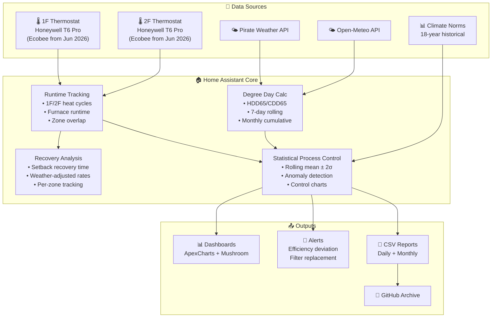
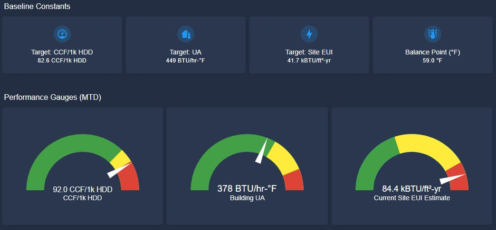
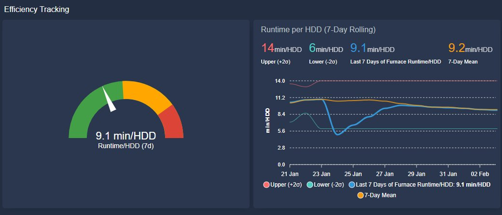
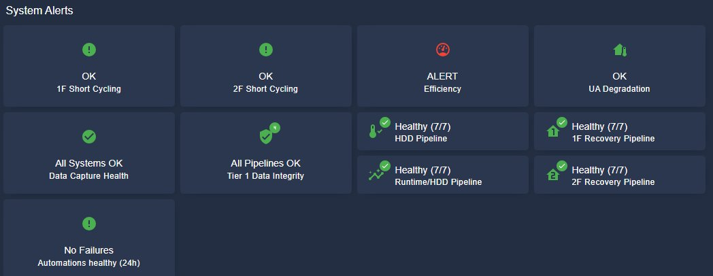

# Residential HVAC Performance Baseline

**A Five-Year Longitudinal Study of High-Efficiency Residential Energy Systems in Climate Zone 5A**

[](https://doi.org/10.5281/zenodo.18232616)
[](https://github.com/wkcollis1-eng/Residential-HVAC-Performance-Baseline-)
[](LICENSE)
[](https://www.home-assistant.io/)
[](https://basc.pnnl.gov/images/iecc-climate-zone-map)
[](data/)
[](https://github.com/sponsors/wkcollis1-eng)

## Overview

This repository documents a comprehensive energy performance baseline for a 2,440 sq. ft. high-efficiency residential structure in Central Connecticut (Climate Zone 5A). The analysis integrates **57 months** of verified utility data (January 2022 - September 2026), high-resolution HVAC runtime telemetry, and independent domestic hot water monitoring to establish diagnostic performance thresholds.

<!-- METRICS_START -->
**Key Findings (Updated September 2026):**
- **Site EUI (12-mo rolling):** 41.7 kBTU/ft²-yr (Oct 2025–Sep 2026 bills [D: (784 CCF × 103.7 + 6,004 kWh × 3.412) / 2,440]; ~31% below the 60.6 regional average [D: 1 − 41.72 / 60.6])
- **Baseline Site EUI:** 41.7 kBTU/ft²-yr — current +0.05% [D: 41.72 / 41.7 − 1], at baseline
- **Heating Intensity:** 102.0 CCF/1k HDD (annual baseline, corrected with Navien DHW metering; rebased 2026-10-10 to ACIS Bradley 2025 HDD65 5,629, was 90.3 on a NOAA 6,270; 2026-10-15 the DHW in CCF, was 100.6)
- **Envelope UA:** 593 BTU/hr-°F (2026-10-15 the DHW in CCF: 3-18% below the code-minimum [D], was 585) (rebased 2026-10-10 to ACIS Bradley 2025 HDD59; 4-19% below the 2021 IECC code-minimum of 610-725 [D]; was 480 and 21-34% below, on NOAA HDD59; rolling recompute pending daily temps past Feb 2026)
- **12-mo Electricity:** 6,004 kWh (Oct 2025–Sep 2026 bills [D]; was 6,468 through June)
- **DHW Optimization:** −35.5% Jan–Sep 2026 YoY [D: 101.01 / 156.63 CCF − 1, both years in CCF] from the recirculation schedule change (~$102 saved in nine months [D: 55.62 CCF × $1.8332], past the ~$77/year projection)
<!-- METRICS_END -->

<!-- HIGHLIGHTS_START -->
## 🆕 Summer 2026 Update Highlights (July–September) + Cooling-Season Thermostat Review

Q3 2026 carried slightly more cooling load than Q3 2025 (610 vs 596 CDD65, BDL [M]). Electricity still fell 17.7% in kWh and 31.7% in dollars [D], and gas fell on DHW alone. The September report adds the first full cooling-season comparison of the Honeywell T6 Pro (2025) against the Ecobee (2026), normalised on BDL CDD65: [SEPTEMBER_2026_UPDATE.md](SEPTEMBER_2026_UPDATE.md).

| Metric | Q3 2025 | Q3 2026 | YoY Change | Status |
|--------|---------|---------|------------|--------|
| Cooling Load (CDD65, BDL) | 596 | 610 | +2.3% [D] | ➖ Similar |
| Heating Load (HDD65, BDL) | 58 | 87 | +29 HDD [D] | ➖ Cooler September |
| Total Gas | 44 CCF | 29 CCF | −34.1% [D] | ✅ DHW-driven |
| Gas Cost | $139.82 | $117.59 | −15.9% [D] | ✅ Lower |
| DHW (Navien) | 40.89 CCF | 22.37 CCF | **−45.3%** [D] | ✅ Recirc program |
| Electricity | 2,628 kWh | 2,164 kWh | −17.7% [D] | ✅ Lower use |
| Electric Cost | $737.75 | $503.96 | **−31.7%** [D] | ✅ Use + rate (−17.0% $/kWh [D]) |
| Cooling Runtime | 238.85 h | 204.84 h (90 of 92 days) | not comparable | ⚠️ Jul 4–5 outage |

Bills are slot months (July–September); degree days are calendar months.

### Cooling-Season Thermostat Review (June–September, BDL CDD65)

| Metric | 2025 Honeywell T6 Pro | 2026 Ecobee | Difference | Status |
|--------|-----------------------|-------------|------------|--------|
| Cooling Load (CDD65, BDL) | 794 | 800 (771 on the 120 logged days) | +6 CDD [D] | ➖ Matched |
| Runtime per CDD, daily-fit slope | 25.96 min/CDD | 19.91 min/CDD | −6.05 min/CDD (95% CI −11.06 to −1.37, p ≈ 0.010) [D] | ✅ Less on hot days |
| Runtime per CDD, season ratio | 25.54 min/CDD | 22.52 min/CDD | −3.02 min/CDD (95% CI −7.95 to +2.72, p ≈ 0.29) [D] | ➖ Not significant |
| Mean runtime on mild days (1–4 CDD) | 0.94 h/day (n=29 days) | 1.45 h/day (n=24 days) | +0.51 h/day [D] | ⚠️ More on mild days |
| Runtime per cycle | not recorded | 26.2 / 28.9 / 24.4 / 18.4 min (Jun–Sep) [D] | — | 🆕 Ecobee only |
| Compressor energy per CDD (Jul–Sep) | not metered | 0.925 kWh/CDD [D: 564.3 kWh / 610 CDD] | — | 🆕 First measured season |
| Compressor draw per call-hour | 4.9 kW (spec file) | 2.725 ± 0.020 kW [D, n=90 days, R² 0.995] | — | ⚠️ Conflict, open (model confirmed 2026-10-15; RLA unread) |

**Key Insights:**
1. **Less runtime per degree-day on hot days, more on mild days, no detectable season difference.** The daily-fit slope fell 6.05 min/CDD (p ≈ 0.010, week-block bootstrap, B=5000). The season-ratio difference is not significant (p ≈ 0.29). Year and thermostat are fully confounded (one summer each), and 2F vent position, setpoints and system mode are unrecorded for 2025, so **no difference is attributed to the thermostat** yet. *Update 2026-10-15 (Bill): all vents were 100% open in summer, so vent position is not a summer confound. The 2025 setpoints and the September 2025 system mode remain unrecorded.* *Later 2026-10-15 (Bill): setpoints and schedules were the same in both summers, and cooling was on through September 2025. With the recorded alternatives gone, the hot-day slope difference is consistent with the thermostat [I: falsifier — a second Ecobee summer at the same settings with a slope back near 26 min/CDD]. One summer each still cannot separate it from weather beyond CDD65.*
2. **The electricity drop is base load, not cooling.** Over identical meter-read windows (120 days each, 779 vs 769 CDD [D]), use fell from 3,141 to 2,526 kWh [M]. It was about 5.15 kWh/day lower in every window [D, n=4, sd 0.39], including the window that ran 49 CDD hotter in 2026. That is roughly 215 W of continuous load [I: 5.15 / 24; falsifier: a drop that varies with ΔCDD as more windows are added]. The cause is unknown; 2025 had no circuit metering. *Update 2026-10-15 (Bill): the only changes were the DHW recirculation and the office computer, now shut down overnight with sleep modes enabled. How the drop splits between them is unmeasured.*
3. **The first measured compressor draw conflicts with the spec file.** The SEM fit gives 2.725 kW per call-hour against the 4.9 kW in `SYSTEM_SPECIFICATIONS.md`, on which the 1,694 kWh 2025 cooling baseline rests. Nothing is corrected until the condenser nameplate is read. *Update 2026-10-15: model 4A7A4048L1000AA confirmed (Bill). RLA and voltage are unread, and the repo holds no record of a 4.9 kW measurement. Still open.*
4. **Jul 4–5 grid outage:** mains dead from 21:00 Jul 4; SEM data resume at 08:00 Jul 5. Neither day has thermostat rows, so July runtime per CDD uses the 29 logged days.

### DHW Recirculation Optimization (January–September 2026)

- **Jan–Sep DHW:** 156.63 → 101.01 CCF (**−35.5% YoY** [D], both years in CCF): 55.62 CCF saved, ~$102 at the 2026 YTD gas rate of $1.8332/CCF [D: $1,096.28 / 598 CCF]
- **Q3 alone:** 40.89 → 22.37 CCF (−45.3% [D]); recirculation 143 → 46 h [M]
- **Recirc hours Jan–Sep:** 487 → 275 h [M] (−43.5% [D])
- **Unit correction:** the H1 figure published in v1.6.0 (−33.9%, 120.0 → 79.3 CCF) summed raw `monthly_summary.csv` cells, several of which hold therms (2024-10 … 2026-01). In consistent CCF, H1 was 115.73 → 78.64 CCF (−32.0% [D]). The historic cells stay uncorrected pending Bill's approval.

See [UPDATES.md](UPDATES.md) for complete monthly analysis, and the [July](JULY_2026_UPDATE.md), [August](AUGUST_2026_UPDATE.md) and [September](SEPTEMBER_2026_UPDATE.md) reports.
<!-- HIGHLIGHTS_END -->

## 🏗️ System Architecture



## 🎯 What Makes This Different

| Traditional Monitoring | This Approach |
|------------------------|---------------|
| "Your furnace ran 4 hours today" | "Your furnace ran 12% more than expected for today's weather" |
| Static efficiency thresholds | Rolling ±2σ control limits that adapt to your home |
| Single-zone analysis | **Chaining Index** quantifies multi-zone coordination |
| Compare to yesterday | Compare to 18-year climate normals for this date |
| Equipment-focused | **Post-Program Efficiency** framework for already-efficient homes |

## 📊 Five-Year Performance Summary

| Metric | 2022 | 2023 | 2024 | 2025 | 2026 YTD |
|--------|------|------|------|------|----------|
| Annual Gas (CCF) | 815 | 764 | 694 | 787 | 598* |
| Annual Elec (kWh) | 6,824 | 6,591 | 6,543 | 6,730 | 4,558* |
| Heating Intensity | 89.8 | 90.8 | 80.3 | 95.5 | 127.7† |
| Site EUI | 42.1 | 40.8 | 38.2 | 41.7 | — |

*Jan-Sep 2026 only (partial year)

†Jan-Jun 2026 only (no furnace runtime Jul-Sep; H1 intensity is winter-weighted and not comparable to the annual figures)

### Statistical Stability (4-Year Baseline)

| Metric | Mean | Std Dev | CV (%) | Status |
|--------|------|---------|--------|--------|
| Heating Intensity (CCF/1k HDD) | 89.1 | 6.2 | 7.0% | ✅ Excellent |
| Site EUI (kBTU/ft²-yr) | 40.8 | 2.1 | 5.1% | ✅ Excellent |
| Electricity Baseload | 9.6 kWh/day | 0.3 | 3.1% | ✅ Exceptional |

## 🚀 Quick Start (Home Assistant Users)

For the full Home Assistant configuration that powers the sensors, dashboards, and automation used to generate this dataset, see the companion repo: [wkcollis1-eng/home-assistant-config](https://github.com/wkcollis1-eng/home-assistant-config).

### Option 1: Full Package (Recommended)

```bash
curl -o /config/packages/hvac_baseline.yaml \
  https://raw.githubusercontent.com/wkcollis1-eng/Residential-HVAC-Performance-Baseline-/main/homeassistant/packages/hvac_baseline.yaml
```

### Option 2: Core Sensor (5 minutes)

The single most useful efficiency metric:
<!--  -->
```yaml
template:
  - sensor:
      - name: "HVAC Runtime per HDD Today"
        unique_id: hvac_runtime_per_hdd_today
        unit_of_measurement: "min/HDD"
        state: >
          
          
          
          {{ ((runtime_hours * 60) / hdd) | round(1) if hdd > 0 else 0 }}
```
<!--  -->
## 📁 Repository Structure

```
├── README.md                     # This file
├── BASELINE_REPORT.md            # Complete technical analysis (17,000+ words)
├── UPDATES.md                    # 🆕 Monthly update log (all months, newest-first)
├── DATA_SUMMARY.md               # Quick-reference metrics and tables
├── METHODOLOGY.md                # Billing-aligned calculation methodology
├── SYSTEM_SPECIFICATIONS.md      # Equipment technical specifications
├── REALTIME_MONITORING_2026.md   # Home Assistant implementation details
├── scripts/
│   └── validate_month.py         # 🆕 Pre-commit validation (V-HVAC-1 through V-HVAC-8)
├── homeassistant/                # Home Assistant configuration
│   ├── packages/
│   │   └── hvac_baseline.yaml
│   └── dashboards/
└── data/                         # Raw operational datasets
    ├── monthly_summary.csv       # 🆕 Derived monthly metrics (all-in-one) — through Sep 2026
    ├── daily_temperature.csv     # Updated through Sep 2026
    ├── monthly_hvac_runtime.csv  # Updated through Sep 2026
    ├── monthly_dhw_navien.csv    # Updated through Sep 2026
    ├── monthly_electricity_eversource.csv   # Updated through Sep 2026
    └── monthly_gas_scg.csv                   # Updated through Sep 2026
```

## 🏠 Property Context

| Attribute | Specification |
|-----------|---------------|
| Location | Central Connecticut, Climate Zone 5A |
| Construction | 2021, Two-story Colonial |
| Conditioned Area | 2,440 sq. ft. |
| Occupancy | 2 residents |
| Primary Heating | American Standard Silver 95 (96% AFUE) condensing gas furnace |
| Primary Cooling | American Standard Silver 14 (4-ton, 14 SEER) split system |
| Zoning | 2-zone (1F/2F); Honeywell T6 Pro thermostats (through May 2026), Ecobee Smart Enhanced from June 2026 |
| Moisture Control | Santa Fe Classic dehumidifier (110 PPD, 700W) |
| DHW | Navien NPE-series condensing tankless |

## 📈 Investigation Thresholds (2026)

| Metric | Baseline | Warning (+10%) | Action (+15%) |
|--------|----------|----------------|---------------|
| Heating Intensity | 102.0 CCF/1k HDD (rebased 2026-10-15; was 100.6, >111 / >116; was 90.3, >99 / >104) | >112 | >117 |
| Runtime Efficiency | 10.9 min/HDD | >12.0 | >12.5 |
| Monthly Space Heat (Jan) | 138 CCF | >152 | >159 |
| Monthly DHW (Jan) | 22.8 CCF | >25.1 | >26.2 |
| Zone Imbalance | 50% ±5% | <42% or >58% | <38% or >62% |


## Live Monitoring Implementation

The baseline analysis feeds into a real-time Home Assistant monitoring system that tracks performance against established thresholds using Statistical Process Control (SPC). This implementation demonstrates how the calculated baselines translate into operational anomaly detection.

### Dashboard Overview

The monitoring system provides continuous validation of system performance:


*Real-time performance tracking against baseline targets with color-coded status indicators*


*Statistical Process Control monitoring showing 7-day rolling means and ±2σ bounds derived from baseline analysis*


*Automated health checks ensuring data capture integrity and alerting on efficiency degradation*

### Key Monitoring Features

* **HDD/CDD Tracking** - Heating/cooling degree days with 7-day rolling averages
* **Efficiency Monitoring** - Runtime per HDD with auto-calculated ±2σ statistical bounds
* **Recovery Rate Analysis** - Setback recovery tracking with weather adjustment
* **Zone Balance Analysis** - 1F/2F runtime distribution and cycle overlap detection
* **Filter Tracking** - Runtime-based maintenance alerts
* **Anomaly Detection** - Automated alerts when performance drifts beyond baseline thresholds

**Full monitoring configuration and implementation details:**
📂 [home-assistant-config](https://github.com/wkcollis1-eng/home-assistant-config)

For additional dashboard views and implementation notes, see [DASHBOARD_EXAMPLES.md](./DASHBOARD_EXAMPLES.md).

---

## ⚠️ Why Standard Utility Programs Don't Apply

This home's exceptional performance (41.7 kBTU/ft²-yr EUI, 33% better than regional average) places it **beyond the design envelope** of traditional utility efficiency programs.

**Key Finding:** Standard interventions (insulation upgrades, equipment replacement) would yield <5% additional savings at costs exceeding 20-year payback periods.

See [UTILITY_PROGRAM_ANALYSIS.md](UTILITY_PROGRAM_ANALYSIS.md) for detailed analysis.

## 📬 Recent Updates

### v1.7.0 (October 2026)
- Added July–September 2026 data and monthly reports ([July](JULY_2026_UPDATE.md), [August](AUGUST_2026_UPDATE.md), [September](SEPTEMBER_2026_UPDATE.md))
- Extended dataset to 57 months
- First cooling-season thermostat comparison, 2025 Honeywell T6 Pro vs 2026 Ecobee, on BDL CDD65: daily-fit runtime slope −6.05 min/CDD (p ≈ 0.010); season-ratio difference not significant (p ≈ 0.29); not attributed to the thermostat (confounds open)
- First measured compressor energy, 0.925 kWh/CDD Jul–Sep [D]; the 2.725 kW draw per call-hour conflicts with the 4.9 kW spec figure (open question; condenser model confirmed 2026-10-15, RLA still unread)
- Q3 electricity −17.7% kWh / −31.7% $ [D]; Q3 DHW −45.3% [D]; Jul 4–5 grid outage documented
- Flagged, not corrected: therms stored as CCF in DHW cells (2024-10..2026-01), the 2025 cooling zone swap, and usage-month labels on 2025 bill rows *(all three corrected 2026-10-15 on Bill's approval; see CHANGELOG [Unreleased], Fixed)*

### v1.6.0 (July 2026)
- Added March–June 2026 data; H1 2026 vs 2025 half-year analysis
- Extended dataset to 54 months
- Gas flat (+2.2%) and −34% DHW on a 12% colder H1; electric bill −22.2%; heating intensity held (−1.5%)
- Thermostats transitioned Honeywell T6 Pro → Ecobee Smart Enhanced (June 2026)
- Corrected `monthly_summary.csv` cost/DHW cells (Feb/Mar 2026) from HA archives
- *(April–May 2026 monthly updates logged in [UPDATES.md](UPDATES.md))*

### v1.4.0 (March 2026)
- Added February 2026 data and analysis
- Extended dataset to 50 months
- DHW optimization savings sustained at -22% YoY
- Runtime efficiency: 8.8 min/HDD (19% better than baseline)
- 2025-2026 heating season cumulative: 720 hrs / 4,529 HDD

### v1.3.2 (February 2026)
- Added January 2026 data and analysis
- Extended dataset to 49 months
- Validated baseline under extreme cold conditions (1,230 HDD)
- Real-time monitoring integration documented

### v1.2.1 (January 2026)
- Fully billing-aligned methodology implementation
- Four-year statistical validation complete
- Home Assistant real-time monitoring system deployed

## 📚 Citation

```bibtex
@misc{collis2026hvac,
  author = {Collis, William K.},
  title = {Residential HVAC Performance Baseline: A Five-Year Longitudinal Study in Climate Zone 5A},
  year = {2026},
  publisher = {GitHub},
  url = {https://github.com/wkcollis1-eng/Residential-HVAC-Performance-Baseline-},
  doi = {10.5281/zenodo.18232616}
}
```

## 🤝 Contributing

Contributions welcome! Particularly interested in:
- Comparative datasets from other climate zones
- Alternative SPC methodologies
- Dashboard improvements
- Multi-fuel system adaptations

See [CONTRIBUTING.md](CONTRIBUTING.md) for guidelines.

## 📬 Contact

- **GitHub Issues:** [Open an issue](https://github.com/wkcollis1-eng/Residential-HVAC-Performance-Baseline-/issues)
- **Repository Owner:** [@wkcollis1-eng](https://github.com/wkcollis1-eng)

## 💝 Support This Project

[](https://github.com/sponsors/wkcollis1-eng)

If this five-year baseline is useful for your own energy monitoring work, consider sponsoring continued data collection.

---

**Version:** 1.7.0 (October 2026)
**Status:** Active Baseline — 57 months of data (validate_month.py V-HVAC-7 HALT closed 2026-10-15: daily temperatures run through Sep 2026)
**Next Update:** October 2026 monthly (first heating month on the Ecobee)
